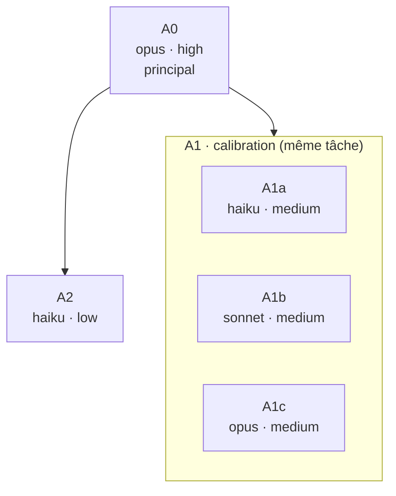

# Recursive orchestration of agents (v8: solo reference, minimal context, mutual learning, reuse first)

Goal: to obtain, by combining the work of agents (the **student agents**) whose **model** and **effort** match the difficulty, a result **of equal or higher quality** than what A0 would have produced alone, faster, then to **learn from every run** (A0 learns from the student agents as much as the student agents learn from their instructions).

## Central principle (LC-031, 2026-10-16)

1. **Minimal context.** Each student agent receives the minimum needed for its task: its slice, the rule that applies, one example, the output format, the search or check tool. Not the whole document, not A0's work, not earlier answers or judgements. A context that is too wide distracts and costs tokens; a context that is too poor is corrected in the next instruction.
2. **Solo reference in parallel.** As soon as the student agents are launched, A0 does **the same task alone** and records it (`orchestration/reference_solo_vN.json`, timestamped) **before reading** any student agent output. No sequential single-agent pilot: a single agent means a single bias, and speed comes from parallelism.
3. **Strict comparison.** The student agents' assembled work is compared point by point with the reference: agreements, disagreements, what the student agents saw and A0 did not, what A0 saw and they did not. Each disagreement is settled **on evidence**, never in A0's favour by default. Re-reading is not comparing: judging the student agents' work with one's own biases is the error to avoid.
4. **Learning in both directions.** What the student agents saw and A0 did not corrects A0's work, tools and skills; what they missed improves their instruction (contextualise, condense, explain, frame, inform). The student agents do not share A0's biases and sometimes find routes it would not have taken.
5. **Deliverable = the best of both**, strictly validated (deterministic evaluator rerun by A0, evidence checked).
6. **An audit that serves.** The performance audit (per student agent, model, effort, instruction) is useful only if it changes something: the next instruction, a tool (new version + test bench cases), a skill (proposed). An error that comes back is flagged as a **recurrence** and corrected further upstream.
7. **Balance between speed and quality.** Neither is sacrificed: the student agents and the reference advance at the same time; the improvement loop runs from one run to the next, not by slowing down the current run.

Principles:
- the **constraints set by the user in the initial request** are respected first, at every step and by every agent;
- tasks are **fragmented as far as possible** so that each sub-task goes to the fastest model that keeps the same quality, under the control of a **critical analysis of over-fragmentation**;
- agents **read and propose**, they modify nothing: each produces a **change document**;
- when all have finished, A0 **merges**, settles the conflicts and **applies** in one pass (new version, never overwrite);
- **redundancy** (several agents on the same task) serves robustness and the measurement of models;
- every **contradiction** is investigated: insufficient effort? insufficient model? ambiguous instruction?
- every run feeds a **performance register**; the **routing table** derived from it guides later choices;
- the org chart is **approved by the user** before any run **of more than 5 agents**; up to 5 agents at a time, no approval is needed (LC-022);
- **A0 always does the task alone in parallel** and compares (central principle);
- **an evaluator is trusted only if it has its negative tests**: a deliberately faulty file that it must reject, and proof that the defect was actually injected (LC-032);
- the backup to the PC is made by A0 alone (skill **sync-cloud-pc**): the relay sends continuously; A0 checks its receipts before and after each wave of agents, and runs the full mode at the end;
- **every delegation has a typed output and a deterministic evaluator** (LC-012):
  - an output schema and a script of hard rules, without an LLM, that the agent runs until `BILAN conforme` ("overall: compliant");
  - **A0 reruns the evaluator itself** on every output: it never relies on the agent's report;
- **performance has several dimensions** (LC-011): alignment, quality, speed, resources used, resources consulted, compactness and share of deterministic automation. Each one is measured and recorded;
- **at every delegation, we seek to automate, reusing first**: every repeated check done by hand (or by an LLM) goes through the tool in `00_competences_claude/outils/` that already covers it (catalogue, `outils/chercher_outil.py`), otherwise through a new version of the closest tool, and only as a last resort through a new tool, with its test bench (skill `cadre-travail-deterministe`, § "Tools: reuse first"). A new tool version is adopted only if the bench shows no drop;
- **what explains is not necessarily what causes** (LC-036): the explanation of a disagreement, of an agent failure or of a tool result remains a hypothesis until the source has confirmed it; this applies to A0's diagnoses as much as to the student agents'.

This skill counts as the user's explicit instruction to choose the model **and the effort level** of each agent, within the user's constraints.

## User constraints (absolute priority)

Before any planning, A0 rereads the initial request and extracts from it **all the constraints set by the user**: budget or credits, allowed or excluded models, effort level, deadline, scope, output format, files not to touch, backup location, etc.
- They take precedence over the lessons, the routing table, the default rules, the fragmentation and the redundancy modes.
- They are listed at the top of the plan (`plan_vN.md`), repeated in the brief of each agent concerned and recalled in the final report.
- If a constraint prevents applying a rule of the skill (e.g. redundancy, Risk = 3), A0 flags it in the plan with the expected consequence; it does not override it.
- A constraint added or modified by the user along the way applies as soon as it is given and triggers a revision of the plan.

## Learning files

**Competence workspace (priority).** It is in `/home/claude/00_competences_claude/`, copied to the PC in `Revision\00_competences_claude\`; its entry point is `LISEZMOI_CLAUDE_vN.md`. It contains:

| Item | Location | Role |
|---|---|---|
| Tool catalogue | `catalogue_outils/catalogue_outils_vN.md` | Generated dictionary: tools are not reread one by one |
| Lesson register | `lecons_apprises/registre_lecons_vN.md` | One lesson = one immutable JSON file, linked to its automatic check |
| Delegations | `delegations_agents/` | One per delegated task, with the results and measurements |
| Task types | `taches_types_automatisables/<type>_vN.json` | Schema, evaluator, automatable steps |
| Test benches | `bancs_essai_outils/` | Fixed cases to compare the versions of a tool |
| Journal | `journal_evenements_outils/` | One immutable event per tool run |

**The skill's folder on the PC** (skill backups, register and routing table):

Folder: `Revision\00_competences_claude\skills_ressources_par_skill\orchestration-agents-recursive\` (device_bash: `$HOME/mnt/Revision/00_competences_claude/skills_ressources_par_skill/orchestration-agents-recursive`).

| File | Role |
|---|---|
| `SKILL_vN.md` | backup of each version of the skill before an update |
| `registre_performance_vN.csv` | one line per agent and per run: model, effort, duration, tokens, precision, recall, F1, lost contradictions and their cause |
| `table_routage_vN.md` | per task type: best, fastest, most balanced (computed from the register) |
| `lecons_vN.md` | lessons drawn from investigations (concrete, dated rules, with the evidence) |
| `scripts/` | `fusion_changements_vN.py`, `appliquer_changements_vN.py`, `registre_performance_vN.py` (always the highest version) |

Always use the **highest version** of each file. Never modify an existing version: write the next one.

## Step 0 – Load past experience (A0)

Before planning, read:
1. in the competence workspace: `LISEZMOI_CLAUDE`, the latest `catalogue_outils`, the `registre_lecons` and the `taches_types_automatisables/` of the type concerned;
2. in the skill's folder on the PC: the latest versions of `table_routage`, `registre_performance`, `lecons` and `scripts/` (`device_stage_files`).

If the workspace or the folder is empty (first use): use the default rules below.

For the task type, reuse what `taches_types_automatisables/<type>_vN.json` describes:
- its output schema and its evaluator;
- its steps that are already automated, which go through the tool and not through an agent.

## Roles

| Role | Who | Responsibilities |
|---|---|---|
| **A0 – Lead (mentor)** | the conversation's model | extracts the constraints, loads experience, builds and fragments the tree, writes the minimal-context instructions, gets the tree approved if there are more than 5 agents, launches the student agents, **does the task alone and records its reference**, compares, settles on evidence, merges, applies, investigates, **learns from the student agents**, updates the register, backs up, reports |
| **Intermediate agent** | node that has children | checks and merges the change documents of its children, adds its own, reports to its parent |
| **Leaf agent** | node without children | analyses, produces its change document, reports |
| **Arbiter** | agent launched by A0 when needed | settles a difficult contradiction, with evidence |

Identifiers: `A0`, `A1`, `A1.1`… Redundant agents on the same task: suffix `a`, `b`, `c` (`A1a`, `A1b`, `A1c`).

**Technical constraint**: an agent launched by A0 does not have the Agent tool. Recursion happens **in the plan**; A0 launches all the agents, from the bottom up (leaves, then intermediates with the deliverables of their children). An agent that judges that a sub-task deserves to be split proposes it in its report; A0 revises the org chart and has it approved again.

## Step 1 – Classify and assess each task

1. **Task type**: choose a stable type (e.g. `revue-complete`, `revue-forme`, `revue-references`, `revue-figures`, `revue-methodes-stats`, `revue-resultats`, `extraction`, `synthese`, `code`, `calcul`). Create a new type only if none fits; note it in the final report.
2. **Complexity score** (1 to 3 per criterion):

| Criterion | 1 | 2 | 3 |
|---|---|---|---|
| **Context** to read | < 5 pages / 1 file | a few files | large corpus |
| **Reasoning** | mechanical | standard analysis | methodology, statistics, trade-offs |
| **Risk** of an error | cosmetic | to be corrected | wrong result, safety-relevant or irreversible decision |
| **Interdependence** | standalone | a few links | strong |
| **Verifiability** | automatic | simple reread | expert judgement |

3. **Choice of model and effort**, in this order of priority:
   1. **User constraints** (section above): they take precedence over everything;
   2. Applicable **lessons** (`lecons_vN.md`);
   3. **Routing table**, if the combination is **reliable** (n ≥ 3): take "fastest" (quality ≥ 90% of the best) for the sub-tasks resulting from fragmentation, "best" if Risk = 3, "most balanced" otherwise;
   4. **Default rule** according to the score: 5–7 → `haiku`/`low`; 8–10 → `sonnet`/`medium`; 11–13 → `opus`/`high`; 14–15 → `opus` or `fable`/`xhigh`.

   Unless the user's constraints say otherwise, **Risk = 3** requires at least `opus`/`high`.

## Step 2 – Fragment as far as possible, under control, then choose the redundancy

### 2.1 Principle
Divide each task **as much as possible** into sub-tasks, so that each can be entrusted to the **fastest model that gives the same quality of result** (routing table: "fastest", quality ≥ 90% of the best; failing that, default rule according to the sub-task's score). A difficult part, once isolated, keeps a strong model; everything else moves down to faster models.

### 2.2 Algorithm (A0, recursive, for each node)
1. **Assess the node** (Step 1) and note the model/effort it would require if it stayed whole.
2. **Propose a split** into sub-tasks with a clear scope (by section, by check category, by file, by type of operation…).
3. **Assess each sub-task** and assign it the fastest model/effort at equivalent quality.
4. **Measure the gain** of the split:
   - **model step-down**: at least one sub-task moves to a faster model or effort than the whole node;
   - **parallelism gain**: the duration of the longest sub-task is clearly shorter than that of the whole node;
   - **risk isolation**: the part with Risk = 3 is isolated, which makes it possible to devote a strong model (or redundancy) to it without paying that cost on the rest.
5. **Critical analysis of over-fragmentation** (below). Then decide:
   - **Fragment**: real gain and no sign of over-fragmentation → apply the algorithm to each sub-task;
   - **Stop**: further fragmentation would be excessive → the node becomes a **leaf** and is entrusted to the chosen agent;
   - **Merge**: the level just created is already too fragmented → regroup the sub-tasks concerned at the previous level (partial merge possible: only the sibling nodes that are too small or too closely linked are regrouped), then reassess the model for the regrouping.

### 2.3 Critical analysis of over-fragmentation
A split is **too fragmented** if any of these signals is present:

| Signal | Test |
|---|---|
| **No gain in model or time** | all the sub-tasks keep the parent's model/effort and parallelism does not clearly shorten the duration |
| **Sub-task too small** | feasible in a few tool calls (≈ 3) or concerns a very short passage: the cost of launching an agent exceeds the work |
| **Duplicated context** | each sub-task has to reread the same large context: the multiplied reading cost exceeds the model gain |
| **Strong coupling between siblings** | Interdependence ≥ 2 between sub-tasks: a correction in one must be propagated to the other (e.g. figure numbering and their citations, a definition and its uses) → keep them together |
| **Global judgement required** | quality depends on an overall view (coherence, synthesis, line of argument) that no sub-task sees alone |
| **Foreseeable merge conflicts** | several sub-tasks would modify the same passages (overlapping anchors) without this being intended redundancy |
| **Budget** | the split exceeds the guardrails (depth, children per node, total number of agents) or a user constraint |
| **Unfavourable history** | a lesson or the routing table shows that a similar granularity degraded quality or gained nothing |

Decision rules:
- one signal on a **sub-task** → merge it with its closest sibling (or attach it to the parent);
- two or more signals on the whole **level** → cancel that level (the parent becomes a leaf);
- no signal but a **marginal gain** → stop: do not fragment further.

### 2.4 Traceability
For each node, record in `plan_vN.md` a line of **fragmentation analysis**: decision (fragment / stop / merge), expected gain (model step-down, parallelism, risk isolation) and over-fragmentation signals found. The actual effectiveness of these decisions is assessed in Steps 6 and 7.

### 2.5 Redundancy
Once the tree is fixed, choose for each leaf a **redundancy mode** (within the user's constraints):

| Mode | When | How |
|---|---|---|
| **Simple** | well-known task type (reliable routing), Risk ≤ 2 | 1 agent |
| **Calibration** | task type absent or provisional in the routing table | 3 agents, same task, different combinations; to measure the effect of the model, keep the same effort and vary the model; to measure the effect of the effort, keep the same model and vary the effort |
| **Consensus** | Risk = 3 | 2 or 3 agents, same task; identical or different models |
| **Overlap** | task cut into blocks (e.g. sections of a long report) | each block extends over its neighbours (e.g. one section on each side); the shared zones check the joins |

Redundancy counts in the agent budget. Do not use it for a mechanical task that is already reliable in the routing table.

## Step 3 – Org chart, judgement and approval (A0)

### 3.1 Judge the plan
- [ ] the user's constraints are listed at the top of the plan and all respected;
- [ ] each node has its fragmentation analysis; each sub-task has the fastest model at equivalent quality; no over-fragmentation signal left unaddressed;
- [ ] each sub-task has a deliverable and a success criterion;
- [ ] no gaps; overlaps are **intended** (redundancy) and indicated;
- [ ] model and effort justified (constraint, lesson, routing table or score);
- [ ] guardrails respected; execution order coherent;
- [ ] reasonable cost in relation to the gain.

### 3.2 Hierarchical org chart (mandatory)
Top-down flowchart; each box shows **the task number, the model and the effort**; redundant agents are grouped. Under the diagram, a **legend** describes each task. Write everything in `orchestration/plan_vN.md` and show it to the user (rendered diagram if possible, otherwise the Mermaid code).



| Task | Type | Model | Effort | Choice based on | Redundancy | Description | Deliverable | Reports to |
|---|---|---|---|---|---|---|---|---|
| A1a | revue-methodes-stats | haiku | medium | calibration | calibration ×3 | … | `changements_A1a_v1.json` | A0 |
| … | | | | | | | | |

Under the legend: a **fragmentation analysis** table (node · decision · expected gain · signals), the user's constraints applied, execution waves, total number of agents, guardrails.

### 3.3 Approval (mandatory)
**Beyond 5 agents, no agent is launched before the user's explicit approval** (LC-022; up to 5 agents, the org chart is shown but execution does not wait; an instruction from the user for the task, for example "no orchestration", always takes precedence) (AskUserQuestion if available: "Approve" / "Modify" / "Cancel"). "Modify" without details: ask what to change. Any modification produces `plan_vN+1.md` and a new presentation. Record `Approuvé le <date heure>` ("Approved on <date time>") in the plan. Session without a user: do not execute.

## Step 4 – Execute

- In waves: all the independent leaves **in the same message** (real parallelism, no lock), then the intermediates.
- **Stay reachable (LC-014).** Here, background tasks are disabled, and the user's messages arrive only with the result of the next tool call.
  - Waves are therefore short: 5 agents at most, and briefs sized for about 20 to 40 min.
  - A0 reads the messages received before each new wave.
- **Load of each agent.** Agents draw from the same token pool as A0. Batches are small and balanced between the agents of one wave; the brief points to tools and skills rather than copying their content. The dashboard (`outils/tableau_de_bord.py`) measures each agent from its transcript (duration, maximum context, tokens) and flags loads above the threshold (G-AG2, 300 k tokens by default) and unbalanced waves (G-AG1, slowest agent at more than 1.5 times the median): the next wave takes this into account.
- **Registered delegation** before launch: `python3 outils/delegation.py ouvrir <delegation.json>` (from `00_competences_claude/`, always through the shortcut). It states the identifier (`D-…`), the task type, the brief, the output schema, the evaluator and the agents. `python3 outils/delegation.py verifier` compares its count with the folder: a "0" with files present is an error, not a result.
- **Solo reference.** As soon as the student agents are launched, A0 does the same task alone, with the same rules and the same output format, and records it in `orchestration/reference_solo_vN.json` (with the time) before reading any student agent output. The reference's evidence goes through the same evaluator.
- Agent tool: `general-purpose` by default, `model` and `effort` from the org chart.
- A0 records for each agent, in `orchestration/metriques_vN.json`: task type, model, effort, redundancy, `duree_s` (duration_ms / 1000), `tokens` (subagent_tokens), `outils` (tool_uses), `perimetre` (categories it was in charge of, or null).

Mandatory brief for each agent (its only context):

```
Identifiant : A1b      Supérieur : A0      Type de tâche : revue-methodes-stats
Contraintes de l'utilisateur à respecter : …
Objectif / périmètre (inclus, exclu et qui traite l'exclu) : …
Contexte minimal : la tranche (passages, lignes ou fichiers exacts), la règle qui s'applique, UN exemple de sortie juste,
                   l'outil de recherche ou de contrôle à utiliser (lecture seule : ne modifier AUCUN fichier source).
                   Ne pas joindre : le document entier, la référence d'A0, les jugements ou réponses antérieurs.
Livrable : <dossier>/orchestration/agents/A1b/changements_A1b_v1.json (format ci-dessous) + rapport_A1b_v1.md
Modèle/effort : sonnet/medium
Schéma de sortie typé : … (champs obligatoires, valeurs permises)
Évaluateur déterministe : <commande> ; à relancer jusqu'à « BILAN conforme » (le dernier essai fait foi)
Outils : ceux de la consigne, appelés par leur raccourci (python3 outils/<outil>.py) ; ne pas écrire de script
         si un outil le fait ; une erreur d'outil est rapportée telle quelle, jamais contournée.
Règles : ne jamais écraser un fichier ; aucun fichier hors du dossier de la tâche (ni /tmp) ;
         pas de synchronisation PC (A0 la fait) ; pas d'autre agent.
         Décomptes du rapport (demandes, verdicts) tirés du fichier livré, jamais de mémoire.
         Vérifier que chaque ancre est présente exactement une fois (python ou grep).
         Propager chaque correction partout où elle a des conséquences (ex. renumérotation d'une figure → toutes ses citations).
         Une information ajoutée de mémoire (volume, pages, DOI, valeur) est signalée « à vérifier » dans la justification.
```

### Format of the change document (JSON, a list)

```json
[{"id": "A1b-01", "agent": "A1b", "fichier": "entree/rapport_v1.md", "section": "1. Méthodes",
  "ancre": "texte actuel cité mot pour mot, assez long pour être unique",
  "proposition": "texte de remplacement complet (ou null pour une question à l'auteur)",
  "type": "correction|ajout|suppression|commentaire", "categorie": "statistiques|references|figures|style|…",
  "gravite": "critique|majeur|moyen|mineur", "justification": "pourquoi, avec la preuve"}]
```

The anchor must appear **exactly once** in the file. For an addition, the anchor is the neighbouring passage and the proposal repeats it with the addition. For a deletion, the proposal is the passage without the deleted part. A comment has `proposition: null` (a proposal identical to the anchor is treated as a comment).

### Report of each agent
```
# Rapport <ID> → <Supérieur>
Statut : terminé | partiel | échec
Modèle/effort : …     Type de tâche : …
Livrables : changements_<ID>_v1.json (N changements), rapport_<ID>_v1.md
Résultat (5 lignes max) : …
Points incertains : …
Signalements hors périmètre (pour qui) : …
Demandes au supérieur : … | aucune
Auto-évaluation : l'effort et le modèle étaient-ils adaptés ? la tâche était-elle trop large ou trop étroite ? (pourquoi)
```

## Step 5 – Merge, settle, apply (A0)

0. **Comparison with the solo reference**: comparison script (element by element: agreement, disagreement, present on one side only) → `orchestration/audit_comparaison_vN.md`. Each disagreement is settled on evidence (source reread, quotation verified), then classified: the student agent was right (error or blind spot of A0), A0 was right (cause in the student agent, Step 6), or legitimate disagreement (to be submitted). The student agents' contributions that are absent from the reference are listed separately: they are the lessons for A0.
0 bis. **Deterministic reassessment**: A0 reruns the evaluator on the output of each agent (same command, new trial folder).
   - A non-compliant output is sent back to the agent (SendMessage) or corrected by A0.
   - The result is recorded: `python3 outils/delegation.py resultat <resultat.json>`, with the measurements — quality (checks passed, coverage), alignment (brief rules), duration, tokens, tool calls, output size, automatic share.
1. **Merge**: `python3 fusion_changements_vN.py <racine> orchestration/fusion_v1.json <documents…>` → groups of **corrections** (`unique`, `consensus`, `conflit`), a separate list of **comments** (questions for the author, never in conflict, all kept), invalid anchors. An invalid anchor is corrected by A0 (by rereading the source) or rejected.
2. **Decisions** (`orchestration/decisions_v1.json`), one per group:
   - `consensus`: accept (several agents agree: high confidence);
   - `unique`: A0 checks in the source before accepting;
   - `conflit`: qualify the **nature**: `formulation` (same correction, different words: keep the best), `complementaire` (compatible corrections: compose a `texte_final` covering the whole zone of the group) or `contradiction` (opposite conclusions: **investigation**, Step 6). Record `perdants` (agents that were wrong);
   - a `retenu` proposal replaces **its own anchor**; only `texte_final` replaces the whole zone of the group;
   - fields: `decision` (`accepte` ("accept") | `rejete` ("reject")), `retenu`, `texte_final` (optional), `nature`, `perdants`, `cause`, `note`.
3. **Open points**: whatever remains ambiguous after investigation is put to the user **before** application.
4. **Application**:
   - text files: `python3 appliquer_changements_vN.py <racine> fusion_v1.json decisions_v1.json v2` → new version of the file, journal, questions for the author (all the comments, by section);
   - `.docx`: skill **application-corrections-rapport** (tracked changes) with the list of accepted changes;
   - `.xlsx`: apply by script in a new version of the workbook.
5. **Check**: compare the old and the new version (`diff`): every accepted change is present, nothing else is modified. Check in particular the **joins** between sub-tasks (consistency of numbering, definitions, cross-references).

## Step 6 – Investigate each contradiction and assess the fragmentation

For each group of nature `contradiction`:
1. **Who is right?** A0 checks in the source, without presuming that its reference is right, and without accepting either the student agent's reason or its own: an explanation that fits is only a hypothesis (LC-036). If it is difficult (Risk = 3 or specialised expertise): launch an **Arbiter** (`opus`/`high`, unless the user's constraints say otherwise) with the source, the conflicting proposals and their justifications; it gives a reasoned verdict.
2. **Why was the loser wrong?** Classify the cause:

| Cause | Clues |
|---|---|
| `effort-insuffisant` | same model with more effort got it right; few tools, few tokens, short duration; self-assessment "insufficient" |
| `modele-insuffisant` | high effort but reasoning error; a higher model got it right at the same effort |
| `consigne-ambigue` | several agents interpreted the scope differently; error consistent with a possible reading of the brief |
| `contexte-manquant` | the agent lacked a file or a piece of information it needed |
| `contexte-trop-large` | the agent got scattered in a context that did not serve its task (high time and tokens, off-topic answer) |
| `biais-A0` | **A0 was wrong**: the student agent saw what the reference missed → correct A0's work, then its tools or its skill |
| `sur-fragmentation` | the error comes from a passage cut between two sub-tasks (correction not propagated, inconsistency at the joins, loss of overall view) |
| `desaccord-legitime` | expert question that is genuinely open: submit to the user |

3. **What we draw from it**:
   - a concrete, verifiable **routing datum** goes to the register and the routing table (e.g. "`revue-methodes-stats`: never `haiku/low`; 2 errors in interpreting a p-value out of 2 runs");
   - a **lesson** is something else: the moral of the story, what the run made understood and what will guide in a new case (story, moral, what changes, observable sign; skill `cadre-travail-deterministe`, § "Learn").

**Assess the fragmentation**: a problem at the joins signals over-fragmentation → lesson "keep X and Y together". A sub-task entrusted to a fast model that achieved the same quality confirms the split → lesson "X can be isolated and entrusted to <model/effort>". Compare the actual duration (the longest agent of each wave) with what the whole task would have taken (register) to measure the gain.

Even without a contradiction, note what an agent **missed** or only **flagged without correcting** (e.g. a correction not propagated): this is often a lesson for the brief.

## Step 7 – Performance audit and learning (A0, at every run)

1. `python3 registre_performance_vN.py fusion_v1.json decisions_v1.json metriques_v1.json <dernier registre ou AUCUN> <dossier> <run_id>` → `registre_performance_vN+1.csv` and `table_routage_vN+1.md` (best / fastest / most balanced per task type). An agent that only **flagged** in a comment a point corrected by another counts for half in its recall.
2. Write `lecons_vN+1.md`: previous lessons + new ones (date, run, evidence), including granularity lessons (splits that worked or failed). A lesson contradicted by 3 later runs is withdrawn (note it). One-off constraints of a run (e.g. budget) are noted in the register, never turned into a general rule.
3. Deposit these files in the learning folder on the PC (`device_commit_files`, new paths only) and verify their checksum.
4. **Scripts**: if a script is corrected, write the next version (`_vN+1.py`) in `scripts/` on the PC, test it on the current run (same expected result + trap case), and note the lesson.
4 bis. **Improvement loop on every tool, competence and test used** (LC-032): which scenario is not covered? how would it occur? how can it be solved? plan, execution, validation by negative test (which first proves that the defect is injected), deployment (new version, bench cases, proposed skill). An error that recurs is noted as a **recurrence** and corrected further upstream.
4 ter. **Performance table**: each error (by A0, by a student agent or by a tool), the method that found it (or the user), the correction and the tool that carries it, and the recurrence, is added to the user's visual register. We show the errors and what changed, never an "everything is fine".
5. **Skill update** — only if a lesson changes the *method* (not the figures, which live in the register and the table):
   1. back up the current skill on the PC as `SKILL_vN.md` (next version) and verify the checksum;
   2. propose the new version to the user (propose_skills, full SKILL.md), summarising the lesson that motivates it.

6. **Automation (LC-012)**: update `taches_types_automatisables/<type>_vN.json`, moving steps from `a_faire` to `automatisee` as soon as a tool exists.
   - For each check done by hand during the run: first look for the tool that covers it (`python3 outils/chercher_outil.py …`), use or improve it (new version through `organiser_outils.py preparer` / `adopter`, standard header, bench cases); write a new one only if nothing does the job, with the `CATALOGUE CONSULTÉ` ("catalogue consulted") line at the top.
   - Run `python3 outils/banc.py <outil> --comparer N N+1`.
   - Regenerate the catalogue (`python3 outils/catalogue.py`) and the overview (`python3 outils/bilan_competences.py`).

The figures (register, routing, benches) improve automatically with each run; the method (this skill) evolves with the user's agreement.

## Step 8 – Backup and final report

- **Backup by A0 alone** (skill sync-cloud-pc): change documents, merge, decisions, new version of the files, metrics, final report. The relay sends continuously; at the end, A0 requires the compliant receipt for each batch, then runs the full mode and requires `N/N conformes` ("N/N compliant") on the whole task folder and on the learning files. No lock is needed: a single actor synchronises.
- Cloud work folder: `/home/claude/<dossier>/` → `Revision\<dossier>\`. The backup recognises only `NN_…` folders: name the task folder accordingly. A file whose content already exists elsewhere in the same folder is not copied (sync-cloud-pc rule).
- `orchestration/rapport_final_vN.md`: comparison of student agents / solo reference (agreements, disagreements settled, contributions of the student agents, A0 errors revealed), the user's constraints and how they were respected, approved org chart, fragmentation overview (time saved, model step-downs obtained, problems at the joins), status of each node, merge overview (consensus / formulation / complementary / contradiction), investigations and causes, extract of the updated routing table, new lessons.
- Reply to the user in a few lines: result, new version of the file, open points, **what the student agents saw and A0 did not**, what the skill learned, backup.

## Guardrails (non-negotiable)

- The constraints set by the user are respected at every step; no rule of the skill overrides them.
- **Maximum depth 3**, **maximum 5 children** per node, **maximum 15 agents** in total (redundancy and arbiters included), unless the user agrees otherwise. Maximum fragmentation stops at these limits.
- Agents modify no source file and do not synchronise.
- No change is applied before the merge is complete and decisions have been made on **all** groups.
- An agent that fails twice on the same task: escalate the failure, do not relaunch in a loop.
- Any irreversible action (deletion, sending, publication) is submitted to the user.
- Never overwrite a file: version it (`_v2`…), including learning files and scripts.
- **No delegation without a deterministic evaluator** and without A0 rerunning that evaluator; **no evaluator without negative tests**.
- **No delegation without A0's solo reference** recorded before the outputs are read.
- The work folder follows the mandatory organisation (skill `cadre-travail-deterministe`). Every deliverable passes `python3 outils/evaluer_travail.py <dossier>` (verdict `CONFORME` ("COMPLIANT")) before being handed over.

## Resulting file tree

```
/home/claude/<dossier>/                       →  Revision\<dossier>\
├── entree/ rapport_v1.md, rapport_v2.md (après application)
└── orchestration/
    ├── plan_v1.md            (contraintes + analyse de fragmentation + organigramme + légende + approbation)
    ├── reference_solo_v1.json, audit_comparaison_v1.md
    ├── metriques_v1.json, fusion_v1.json, decisions_v1.json
    ├── application_v2.md, questions_auteur_v2.md
    ├── rapport_final_v1.md
    └── agents/<ID>/ changements_<ID>_v1.json, rapport_<ID>_v1.md
Revision\00_competences_claude\skills_ressources_par_skill\orchestration-agents-recursive\
    SKILL_vN.md · registre_performance_vN.csv · table_routage_vN.md · lecons_vN.md · scripts\
```

